# T242 — Project Huntsman
**IFB398 IT Capstone Phase 1 | QUT 2026 Semester 2**

---

## Project Overview

Project Huntsman is an 8-legged spider robot developed by V Source Development, designed for deployment in post-disaster search and rescue environments. The robot has 24 servo motors (3 per leg) controlled by an ESP32, with a Raspberry Pi 5 as the onboard compute and ML inference platform.

Our Phase 1 work covers the ML-based gait control system — teaching the robot to walk across unpredictable terrain using reinforcement learning — along with the operator interface and hardware integration layer.

---

## Team T242

| Name | Role | GitHub |
|------|------|--------|
| David Murhi | Team Lead / Project Manager / Simulation | @davidmurhi |
| Tom Huynh | Frontend / Operator Dashboard | @tomotthyy |
| Kai Langley | ML / Simulation | @kai12345689 |
| Prabhanjan Muthukannan | Hardware / Embedded Systems | @Prab-QUT |

## Industry Partner

Craig Schneider — Founder and CTO, V Source Development  
craig@vsource.dev | www.vsource.dev

---

## Tech Stack

| Layer | Technology |
|---|---|
| Physics simulation (Phase 1 RL) | PyBullet + URDF |
| Physics simulation (Sprint 5 rebuild) | MuJoCo 3.x (MJCF XML) |
| RL environment | Gymnasium |
| RL algorithm | PPO via Stable Baselines 3 |
| Onboard compute | Raspberry Pi 5 |
| Motor control | ESP32 + PWM (24 servos) |
| Operator interface | SvelteKit |
| Embedded firmware | C/C++ (ESP32) |

---

## Simulation Screenshots

### Kai's Spider — PyBullet Prototype (Sprints 2–4)

The primary Phase 1 RL output. Full 8-leg model (`spider8_v5_longbody_3joint.urdf`) trained with PPO to navigate a staggered obstacle course.

<table>
<tr>
<td width="33%">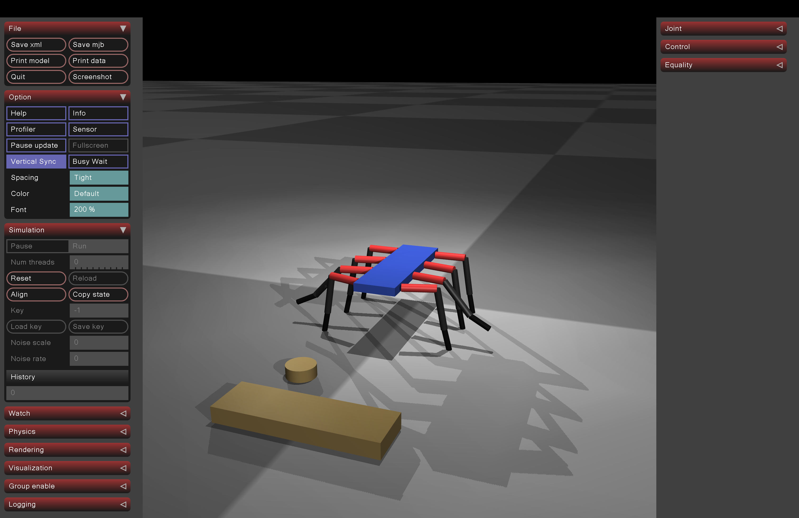</td>
<td width="33%">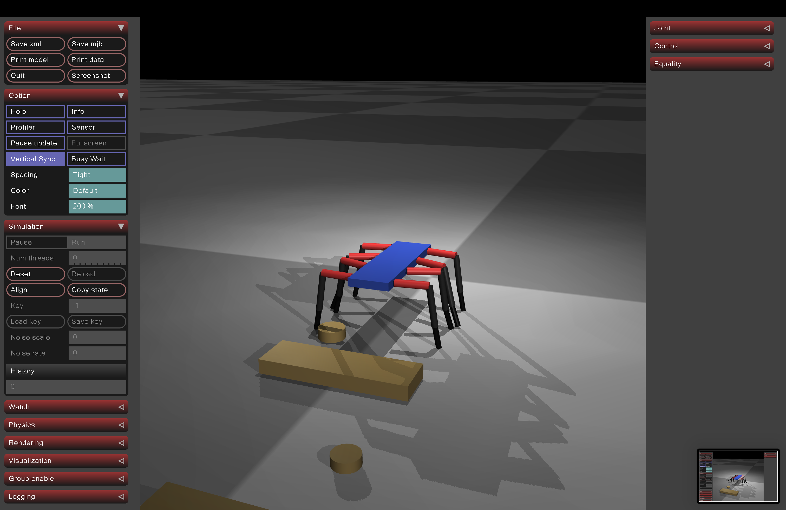</td>
<td width="33%">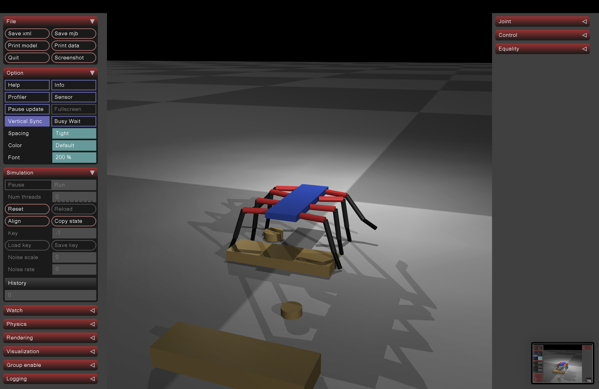</td>
</tr>
<tr>
<td><em>Angled traverse — obstacle course</em></td>
<td><em>Block obstacles — wave gait active</em></td>
<td><em>Cylindrical obstacle navigation</em></td>
</tr>
</table>

<table>
<tr>
<td width="33%">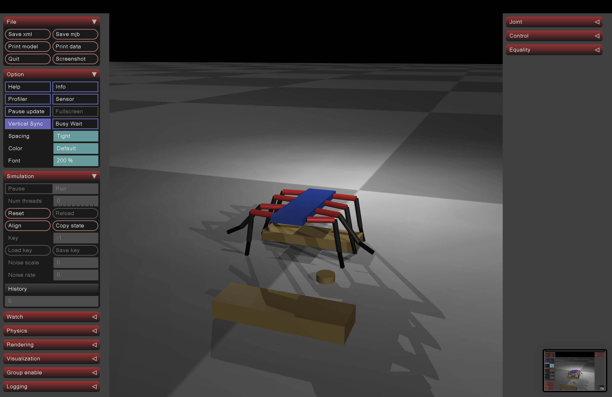</td>
<td width="33%">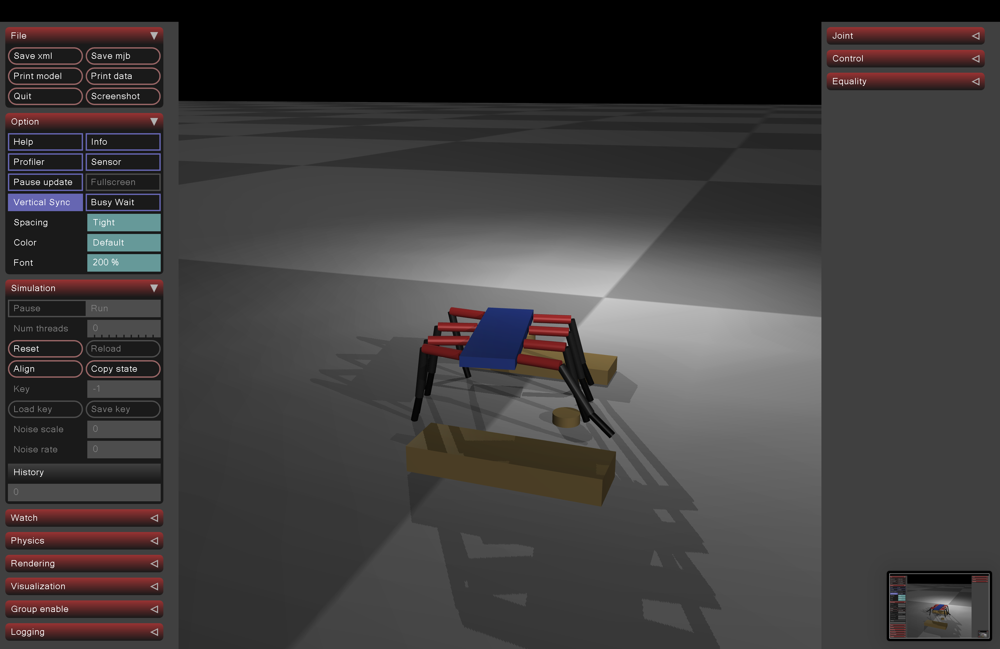</td>
<td width="33%">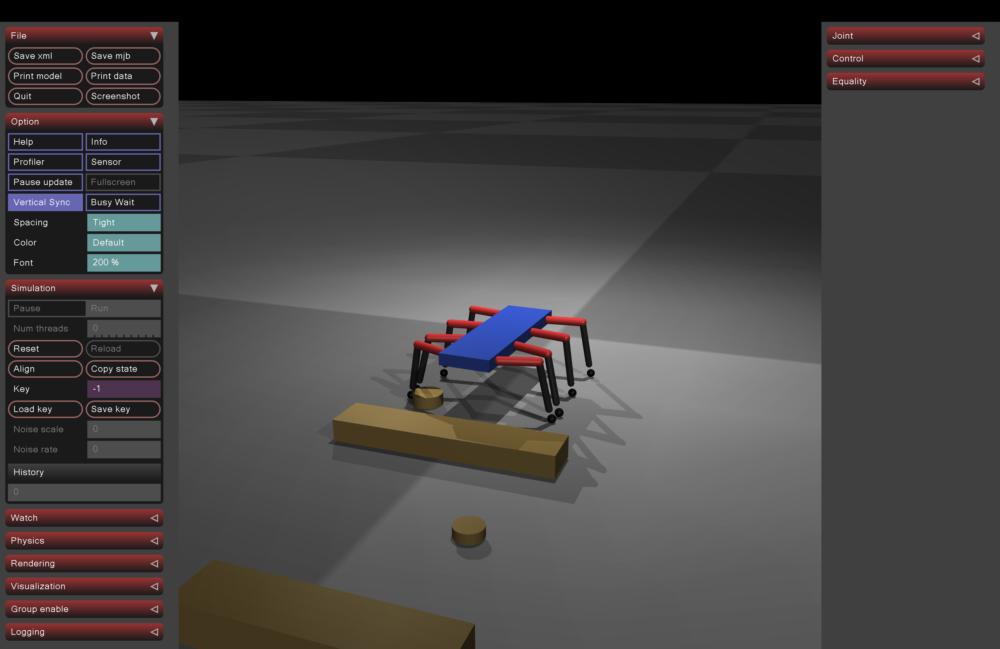</td>
</tr>
<tr>
<td><em>Top-down — obstacle course</em></td>
<td><em>Instability case — led to MuJoCo rebuild</em></td>
<td><em>Foot contact spheres (touch sensors)</em></td>
</tr>
</table>

<table>
<tr>
<td width="50%">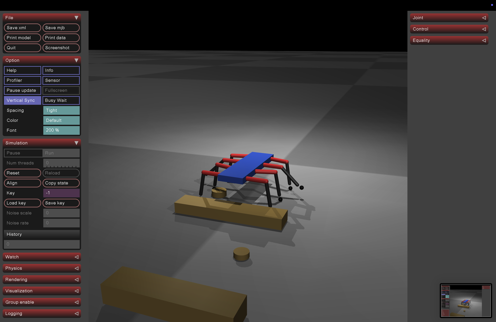</td>
<td width="50%">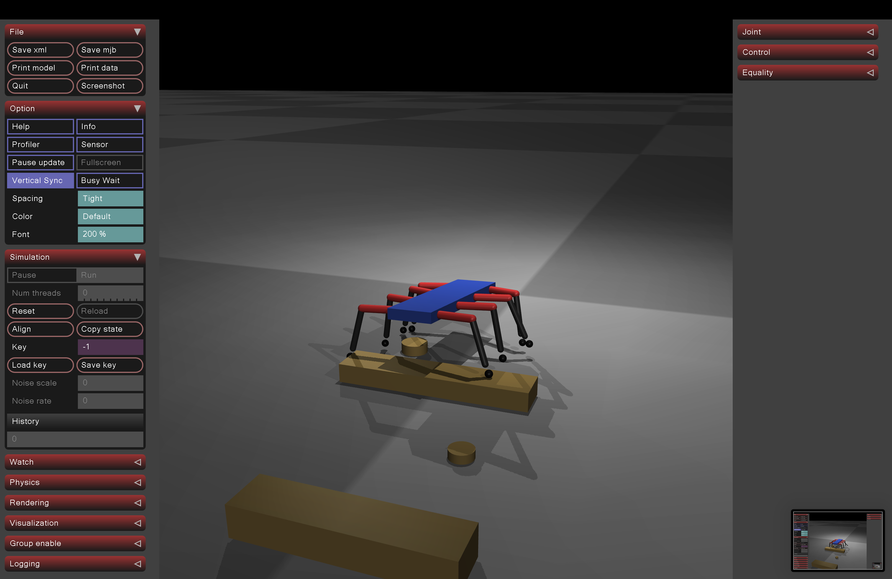</td>
</tr>
<tr>
<td><em>Contact points during stance phase</em></td>
<td><em>Multi-contact — wave gait in progress</em></td>
</tr>
</table>

### David's MuJoCo Rebuild (Sprint 5)

Ground-up rebuild from Craig's confirmed hardware dimensions. Each step is validated independently before the next is added.

<table>
<tr>
<td width="50%">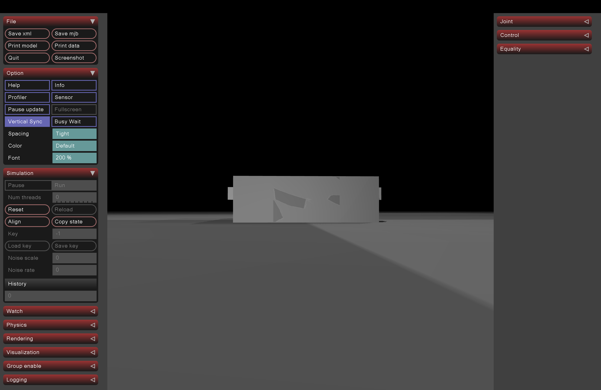</td>
<td width="50%">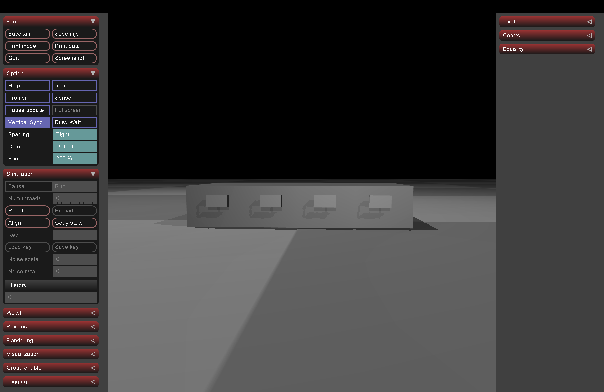</td>
</tr>
<tr>
<td><em>Step 1: huntsman_body.xml — settles at z=0.035m, zero tilt</em></td>
<td><em>Step 1: 8 leg attachment pads — geometry validated</em></td>
</tr>
</table>

---

## Technical Diagrams

### Leg Geometry

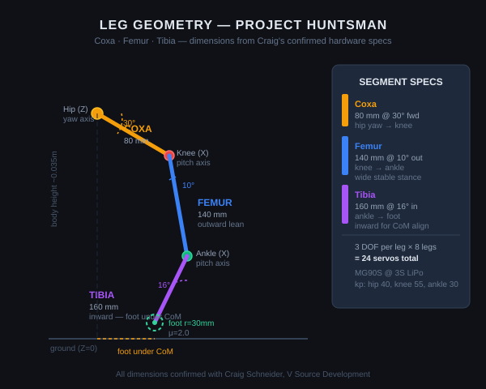

Three segments per leg derived from Craig's confirmed hardware specs. Coxa forward at 30° provides reach without body collision. Femur outward at 10° gives a wide, stable stance. Tibia inward at 16° places the foot under the centre of mass for lateral stability.

### System Architecture

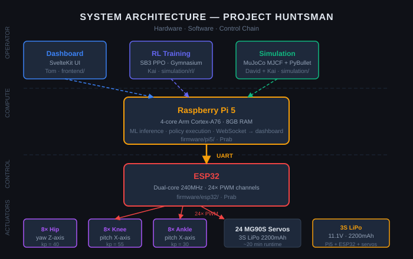

Pi 5 runs RL inference and sends joint targets over UART to the ESP32, which drives 24 PWM servo channels. The SvelteKit dashboard connects to the Pi 5 over WebSocket for real-time monitoring.

### Wave Gait Pattern

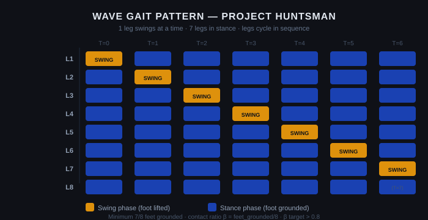

One leg swings at a time while 7 remain grounded. The contact-ratio reward (He et al. 2024) pushes the policy toward this pattern without it being hardcoded — the robot learns it as the most stable locomotion strategy.

### RL Reward Function

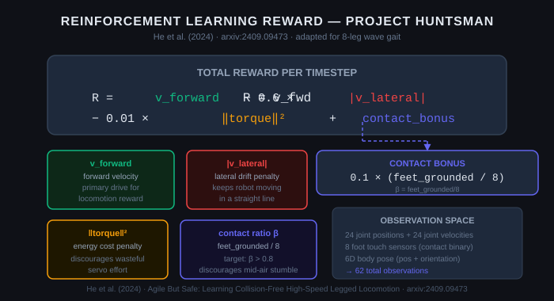

Forward velocity as primary reward, lateral drift penalty to maintain a straight line, torque penalty for energy efficiency, and a contact-ratio bonus that encourages the wave gait to emerge naturally.

---

## Repository Structure

```
/simulation
  /capstone spider robot   — PyBullet URDF prototypes (v1–v6, Sprints 2–4, Kai)
  /current spider robot    — current PyBullet environment
  /mujoco                  — MuJoCo rebuild from hardware first principles (Sprint 5, David)
    /mjcf                  — MJCF model files
      huntsman_body.xml    — Step 1: body geometry + physics (validated)
      huntsman_l1.xml      — Step 2: body + L1 leg (validated)
    /viewer                — interactive viewer scripts
      huntsman_body.py     — view body (SPACE/R/Q)
      huntsman_l1.py       — view + control L1 leg (H/K J/U N/M)
    /tests                 — unit tests (pytest)
      test_simulation.py   — 12 tests: mass, geometry, physics stability
  /rl                      — RL training scripts
    train_ppo.py           — PPO training (Stable Baselines 3)
    run_policy.py          — load + run trained policy
  spider_env.py            — Gymnasium + PyBullet wrapper (Kai)

/.github/workflows/ci.yml  — GitHub Actions: auto-runs tests on push

/docs
  /sprints                 — Sprint 1–6 plans and retrospectives
  /hardware                — Hardware spec (confirmed with Craig)
  /design                  — Simulation design decisions and rationale
  /media                   — Simulation screenshots and technical diagrams

/dashboard                 — SvelteKit operator interface (Tom)
/firmware                  — Pi 5 + ESP32 firmware (Prab)
/research                  — Research notes and references
/frontend                  — SvelteKit project root
```

---

## Hardware Summary

- **Robot mass:** ~1.207 kg total
- **Body:** 447g aluminium frame
- **Legs:** 8 × 3 DOF (hip yaw + knee pitch + ankle pitch) = 24 MG90S servos
- **Control chain:** Pi 5 → UART → ESP32 → 24× PWM servo channels
- **Battery:** 3S LiPo 2200mAh (~20 min runtime at full load)

Full spec: [`docs/hardware/hardware_spec.md`](docs/hardware/hardware_spec.md)

---

## Simulation Build Plan (MuJoCo)

The MuJoCo simulation is built one validated step at a time from Craig's confirmed hardware dimensions.

| Step | File | Status |
|---|---|---|
| 1 | `huntsman_body.xml` | Done — body geometry, mass, inertia validated |
| 2 | `huntsman_l1.xml` | Done — body + L1 leg, joint geometry, foot sensor validated |
| 3 | `huntsman_full.xml` | In progress — all 8 legs |
| 4 | Gait controller | Planned — wave gait (1 swing, 7 stance) |
| 5 | Gymnasium wrapper | Planned — full RL interface for new model |
| 6 | PPO training | Phase 2 |

Design rationale: [`docs/design/simulation_design.md`](docs/design/simulation_design.md)

---

## Quick Start — PyBullet (Kai's RL Environment)

The primary Phase 1 simulation. Uses PyBullet + URDF with a Gymnasium wrapper trained by PPO.

```bash
pip install pybullet gymnasium stable-baselines3 numpy

# Run a trained policy in the viewer
cd simulation
python rl/run_policy.py

# Run a specific trained model
python rl/run_policy.py --model rl/models/spider8_ppo_500000_steps.zip

# Train from scratch (1M steps, ~30 min on GPU)
python rl/train_ppo.py

# Train longer (5M steps — for Craig's compute)
python rl/train_ppo.py --timesteps 5000000

# Monitor training with TensorBoard
tensorboard --logdir simulation/rl/logs
```

The Gymnasium environment (`spider_env.py`):
- **Action space:** 24 normalised servo targets [-1, 1]
- **Observation space:** 31D (joint positions + velocities + body pose)
- **Reward:** forward velocity − lateral drift penalty + contact ratio bonus

---

## Quick Start — MuJoCo (David's Hardware-First Rebuild)

Sprint 5 rebuild from Craig's confirmed hardware specs. This is the foundation for Phase 2 RL training.

```bash
pip install mujoco numpy pytest

# View body (Step 1)
mjpython simulation/mujoco/viewer/huntsman_body.py

# View + control L1 leg (Step 2)
# Controls: H/K=hip  J/U=knee  N/M=ankle  SPACE=pause  R=reset  Q=quit
mjpython simulation/mujoco/viewer/huntsman_l1.py

# Run all unit tests (12 tests: mass, geometry, physics stability)
python -m pytest simulation/mujoco/tests/ -v
```

---

## Sprint History

See [`docs/sprints/sprint_plan.md`](docs/sprints/sprint_plan.md) for full sprint plans and retrospectives.

| Sprint | Weeks | Key output |
|---|---|---|
| 1 | Wk 1–2 | Project setup, Craig kickoff, roles confirmed |
| 2 | Wk 3–4 | First PyBullet prototype, hardware scoped |
| 3 | Wk 5–6 | Gymnasium wrapper, PPO pipeline (Kai) |
| 4 | Wk 7–8 | He et al. contact-ratio feedback, obstacle testing |
| 5 | Wk 9–10 | MuJoCo rebuild from hardware first principles (David) |
| 6 | Wk 11–12 | Full 8-leg model, A2 presentation (Week 12) |

---

## Research

- He et al. (2024). *Agile But Safe: Learning Collision-Free High-Speed Legged Locomotion*. [arxiv:2409.09473](https://arxiv.org/abs/2409.09473)
- Stable Baselines 3 — PPO implementation and Gymnasium integration notes: [`research/`](research/)

---

## Branch Strategy

- `main` — stable only
- `dev` — active development
- `simulation` — RL and simulation work
- `dashboard` — SvelteKit dashboard
- `firmware` — Pi 5 and ESP32 firmware
