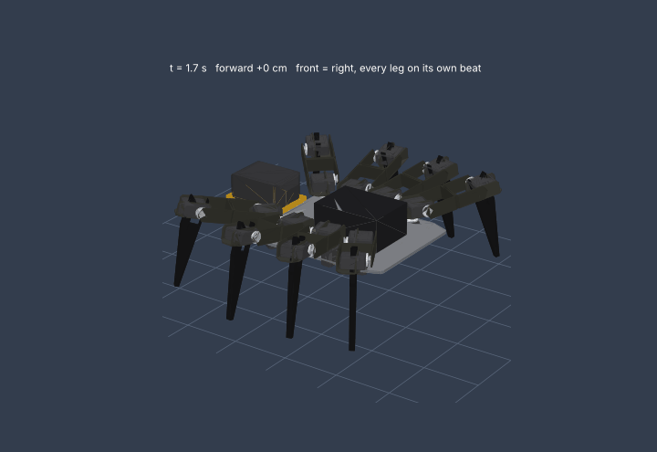
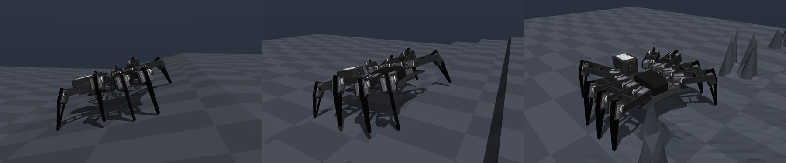
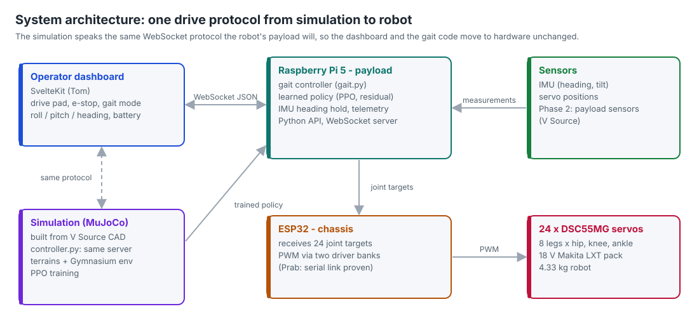

# Project Huntsman: learned gait control for a search-and-rescue spider robot

> **Public copy for QUT assessment.** V Source Development's design files (CAD, part weights, photos,
> videos and the simulation geometry generated from the CAD) are not included; see
> [PUBLIC_COPY.md](PUBLIC_COPY.md). Everything the team wrote is here with its history.

**Team T242 | QUT IFB398 IT Capstone, Phase 1 (2026 Semester 2) |
Industry partner: [V Source Development](https://www.vsource.dev)**

V Source is building **Huntsman**, eight-legged robots that walk into
disaster zones where wheels and tracks cannot go. They search for
survivors and keep rescuers informed. Their current controller walks
on flat ground only. Our project is the **walking gait control
system**: teach the robot to cross rubble, slopes and steps with
machine learning, and run that controller on the robot's Raspberry Pi 5
and ESP32 stack.

<p align="center">

<br><em>Our simulation, generated from V Source's CAD.</em>
</p>

## For assessors: where to find the evidence

Every artefact linked from our Phase 1 report is in this repository and opens
without an account. V Source's own photos, videos and CAD renders are on our
[Canvas group page](https://canvas.qut.edu.au/groups/225191/pages/project-huntsman-partner-evidence-teaching-team-only) (teaching team only).

| Report section | Evidence |
|---|---|
| **Definition** | [Project definition and requirements](docs/project/definition.md) · [risks, ethics and governance](docs/project/risks_and_ethics.md) · [partner kickoff minutes](docs/meetings/2026-09-02_craig_kickoff.md) · [user stories (product backlog)](docs/agile/backlog.md) |
| **Planning** | [Phase 1 sprint record](docs/sprints/phase1.md) · [Phase 2 plan](docs/sprints/phase2_plan.md) · [decision records](docs/decisions/README.md) · [how we work](docs/agile/way_of_working.md) |
| **Outputs** | [MuJoCo simulation from the CAD](simulation/mujoco/) · [PyBullet prototype and PPO training](simulation/pybullet/) · [operator console](dashboard/) · [Pi 5 to ESP32 link](firmware/README.md) · [tests and CI](docs/testing.md) |
| **Operation** | [meeting notes and tutor summaries](docs/meetings/README.md) · [contributing and review rules](CONTRIBUTING.md) · [code owners](.github/CODEOWNERS) |
| **Images and video** | [image gallery](docs/media/GALLERY.md) · [video index](docs/media/video/VIDEOS.md) · [operator controls](docs/media/video/controls_demo.mp4) · baseline gait on [slope](docs/media/video/terrain_slope.mp4), [mixed ground](docs/media/video/terrain_mixed.mp4), [steps](docs/media/video/terrain_steps.mp4) and [rubble](docs/media/video/terrain_rubble.mp4) |

## The two spiders

<table>
<tr>
<th width="50%">Phase 1 prototype: PyBullet (Kai)</th>
<th width="50%">CAD-calibrated platform: MuJoCo (David)</th>
</tr>
<tr>
<td></td>
<td></td>
</tr>
<tr>
<td>Built from Craig's description before any CAD existed. It proved
the pipeline: 24-joint URDF, keyboard-driven wave gait, Prab's
Gymnasium environment, and a PPO policy that moves after 2 M steps.</td>
<td>Generated from V Source's Inventor CAD: every part, joint axis and
mass (4.326 kg). Foot-path gait with four modes. Drivable from keyboard,
drive pad or dashboard. Rough terrains and a residual-RL training
environment for Phase 2.</td>
</tr>
</table>

### Quick start: CAD-calibrated simulation

The MuJoCo model is built from V Source's CAD files, which are not in this
public copy, so this step runs only in the team's private repository. The
[controls video](docs/media/video/controls_demo.mp4) shows it running.

```bash
git clone https://github.com/davidmurhi/T242-Project-Huntsman.git   # private: team and V Source only
cd T242-Project-Huntsman/simulation/mujoco
python3 -m venv .venv && source .venv/bin/activate     # Windows: .venv\Scripts\activate
pip install -r requirements.txt
python spider.py --save          # build the robot from the CAD; prints its checks
python controller.py             # drive it: arrows/WASD, Q/E sideways, 1-4 gaits, X e-stop
python controller.py --terrain rubble     # or slope, steps, mixed
```

The same window serves a drive pad at http://localhost:8765, and the
team's dashboard can connect on `ws://localhost:8765/ws`.

### Quick start: PyBullet prototype

This one runs from this public copy:

```bash
git clone https://github.com/davidmurhi/t242-huntsman-public.git
cd t242-huntsman-public/simulation/pybullet
python3 -m venv .venv && source .venv/bin/activate
pip install -r requirements.txt  # Apple Silicon + Python 3.13: pip install pybullet-arm64
python spider8_v6.py             # arrows/WASD to drive, E/Q gears, Space to stop
```

More in [`simulation/README.md`](simulation/README.md).

## Where it stands (end of Phase 1)

| | |
|---|---|
| Simulation | built from the partner's CAD, reproducible in CI, matches the weight sheet |
| Baseline gait | flat ground: straight to about 1 mm over 3 m, no leg contact; 15 deg slopes: yes; 50 mm steps and 80 mm rubble: stalls. This gap is the target for the learned controller |
| Learning | PPO pipeline proven on the prototype; CAD-model training environment with terrains, randomisation and curriculum ready |
| Hardware | Pi 5 to ESP32 serial link proven; servo PWM mapping written; robot photos, video and CAD received |
| Operator interface | SvelteKit console (mission control, map, diagnostics); live telemetry and drive protocol defined |
| Quality | 64 automated tests; CI on every push |

<p align="center"></p>

## Repository

```
simulation/
  mujoco/              CAD-built simulation, gait, controller, terrains, RL environment, tests
  pybullet/            Kai's prototype, Prab's Gymnasium env, telemetry bridge, PWM mapping, tests
  mujoco-evaluation/   Sprint 3 framework evaluation and diagnostic harness
dashboard/             SvelteKit operator console (Tom)
firmware/              Pi 5 and ESP32 integration notes (Prab)
hardware/              (not in this copy) V Source's CAD, part weights, photos and video
docs/                  project definition, sprints, backlog, decisions, meetings, testing, diagrams
research/              research links and notes
tools/                 diagram and render generators, CI helpers
```

## Documentation

* **Definition:** [project definition](docs/project/definition.md),
  [risks, ethics and governance](docs/project/risks_and_ethics.md)
* **Plans:** [Phase 1 sprint record](docs/sprints/phase1.md),
  [Phase 2 plan](docs/sprints/phase2_plan.md),
  [backlog](docs/agile/backlog.md)
* **Outputs:** [architecture](docs/architecture.md),
  [decision records](docs/decisions/README.md),
  [testing](docs/testing.md)
* **Operation:** [how we work](docs/agile/way_of_working.md),
  [meetings](docs/meetings/README.md),
  [contributing](CONTRIBUTING.md)



## Team T242

| | Role | Owns |
|---|---|---|
| David Murhi ([@davidmurhi](https://github.com/davidmurhi)) | Team lead, project manager | partner and tutor communication; CAD-calibrated simulation, gait and controller; repository and CI |
| Kai Langley ([@kai12345689](https://github.com/kai12345689)) | ML and simulation | PyBullet prototype, PPO training |
| Prabhanjan Muthukannan ([@Prab-QUT](https://github.com/Prab-QUT)) | Hardware and embedded | Pi 5 and ESP32, Gymnasium environment, telemetry bridge, servo mapping |
| Tom Huynh ([@tomotthyy](https://github.com/tomotthyy)) | Operator interface | SvelteKit dashboard, telemetry protocol |

**Industry partner:** Craig Schneider, Founder and Technical Director, V Source
Development. CAD and part data by V Source
engineer Ronan Donahoe.

V Source's hardware files (CAD, part weights, photos and video) belong to
V Source Development and are shared for this project only; they are not in
this public copy.
