# Image gallery

Images the team produced in Phase 1. V Source's photos of the physical robot
and renders of its CAD are on our [Canvas group page](https://canvas.qut.edu.au/groups/225191/pages/project-huntsman-partner-evidence-teaching-team-only)
(teaching team only).

## The CAD-built MuJoCo model

| | |
|---|---|
|  | 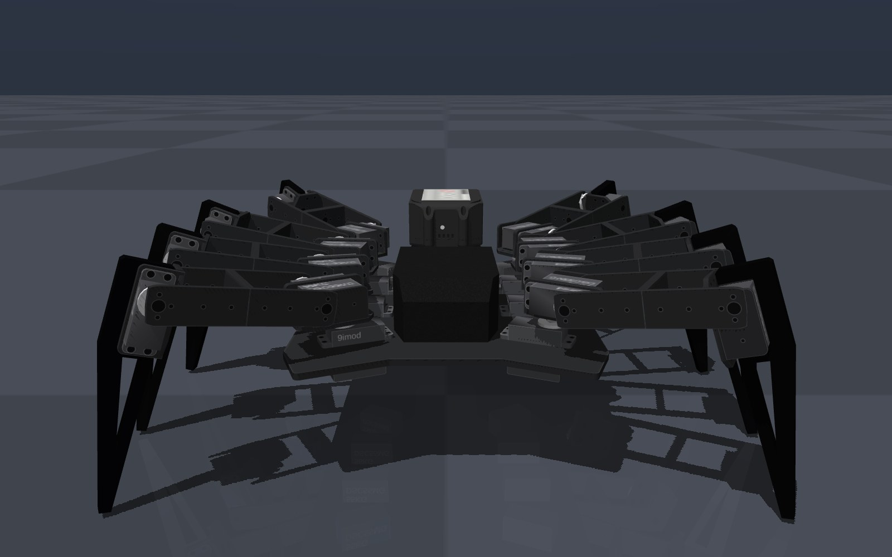 |
| Generated from V Source's Inventor CAD: every part, joint axis and mass (4.326 kg in total). | Front view. |
| 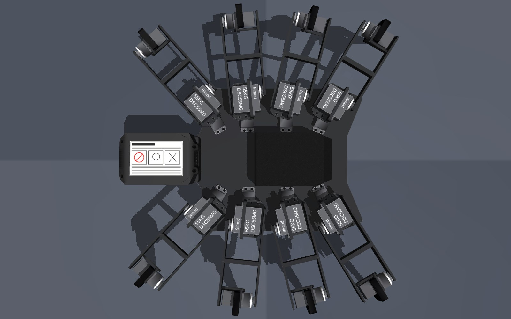 | 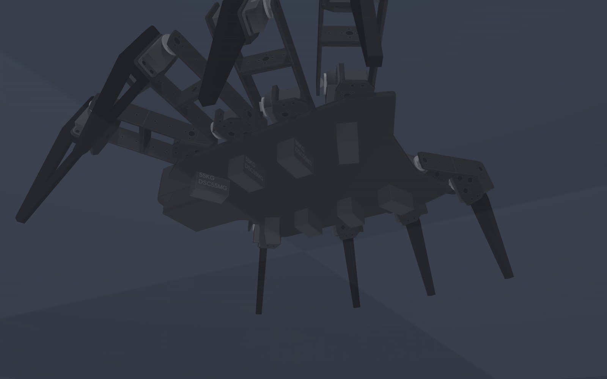 |
| From above: eight legs, three servos each. | From below. |
| 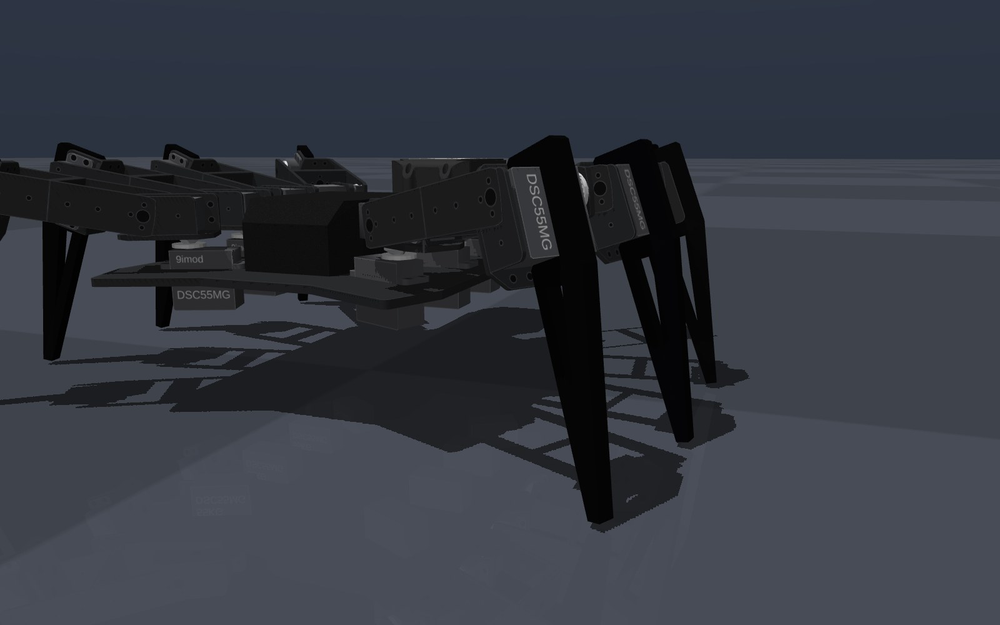 | 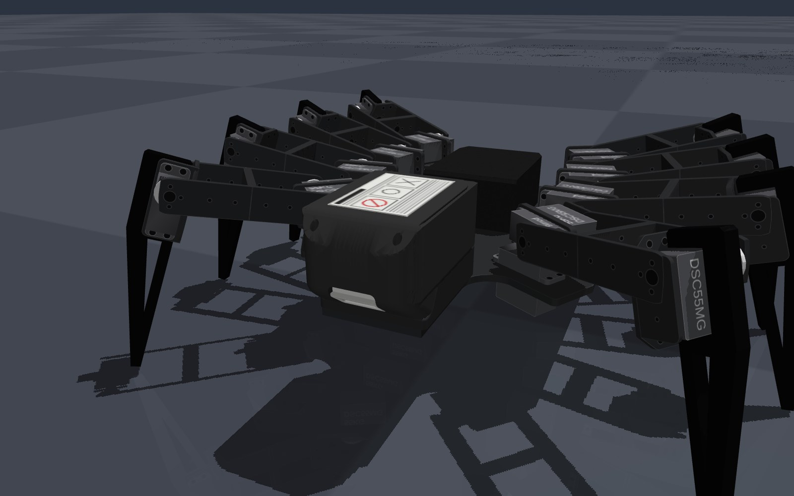 |
| Side view, showing the three servos on each leg. | Rear view with the Makita 18 V battery, which we identified from V Source's photos and modelled before the CAD arrived. |

## The test terrains

The terrains used to measure the hand-written baseline gait, with a 30 s
recording of each run:

| Terrain | Baseline gait, distance in 30 s | Recording |
|---|---|---|
| 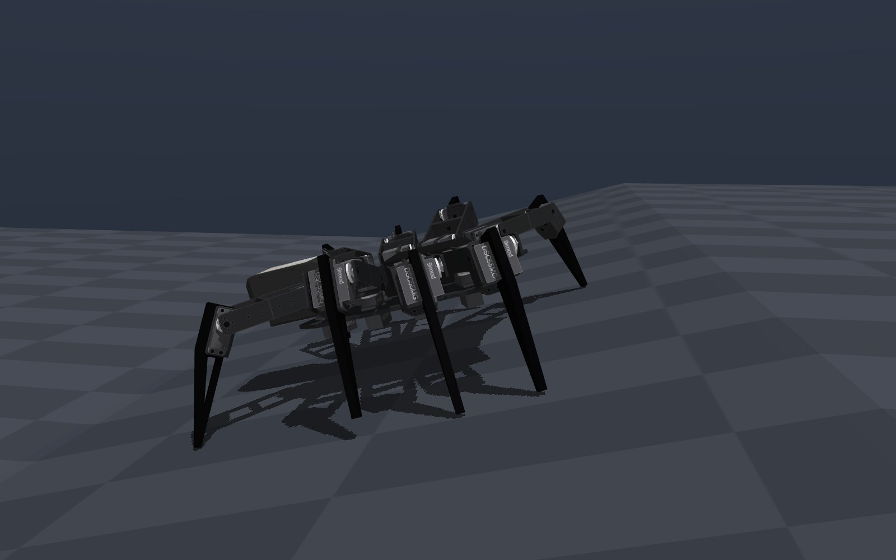 15° slope | 3.5 m | [video](video/terrain_slope.mp4) |
| Mixed ground (slope, steps and rubble) | 2.9 m | [video](video/terrain_mixed.mp4) |
| 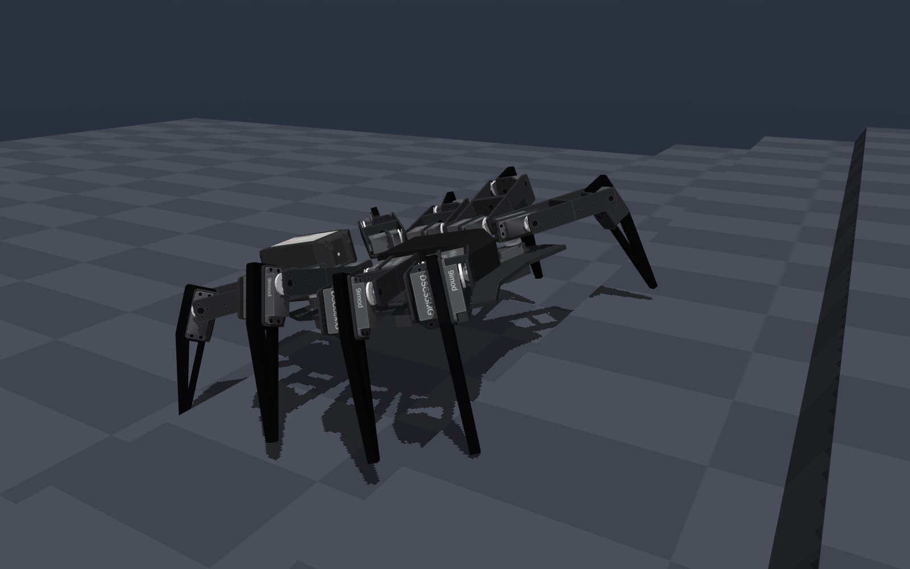 50 mm steps | 0.8 m | [video](video/terrain_steps.mp4) |
| 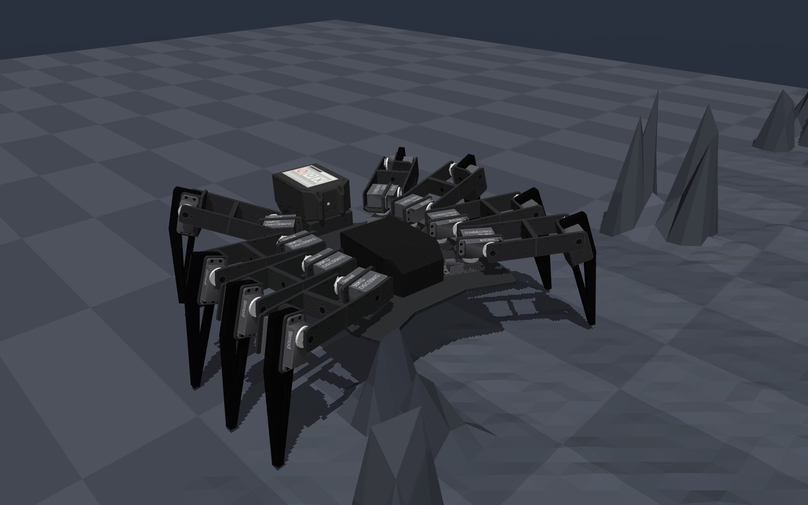 80 mm rubble | 0.6 m | [video](video/terrain_rubble.mp4) |

The Phase 2 target is more than 3 m in 30 s on steps and rubble.

## The PyBullet prototype (Kai)

| | |
|---|---|
|  | 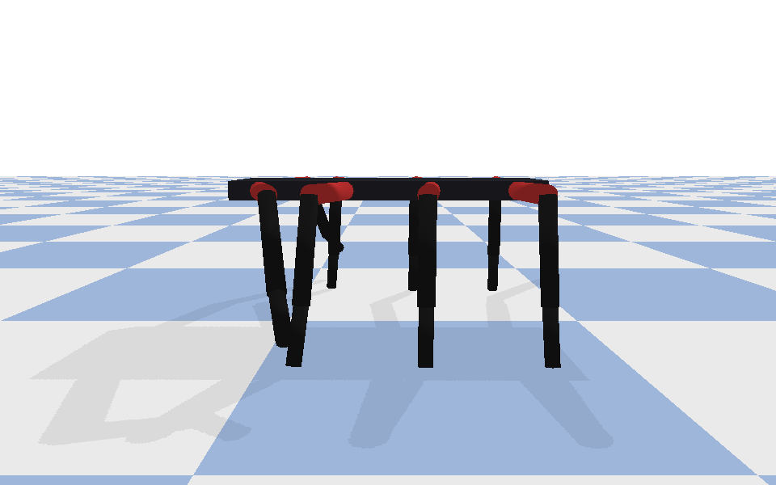 |
| The placeholder spider built from Craig's description before the CAD existed. | Side view. |
| 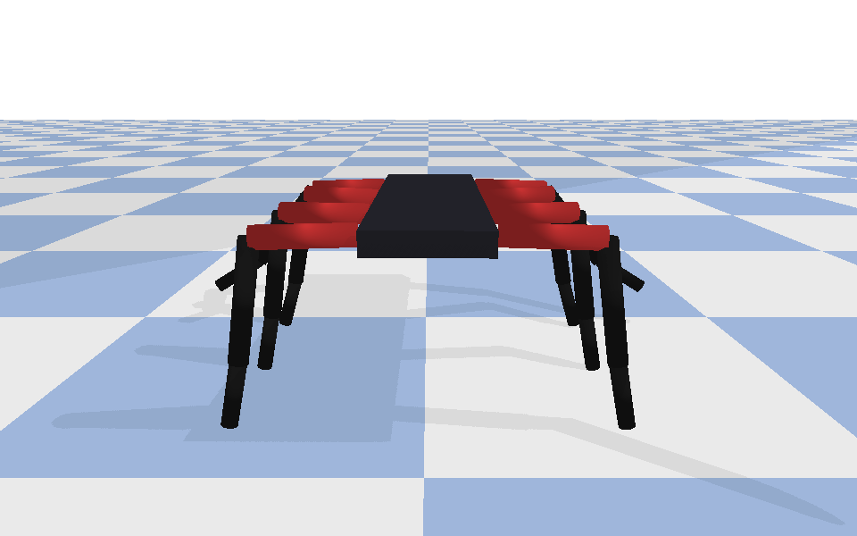 | 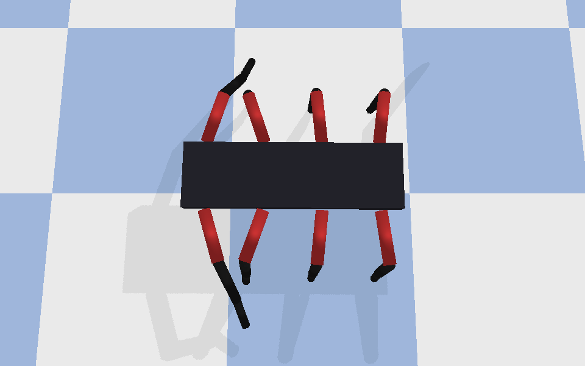 |
| Front view. | From above. |

## The operator console (Tom)

| | |
|---|---|
| 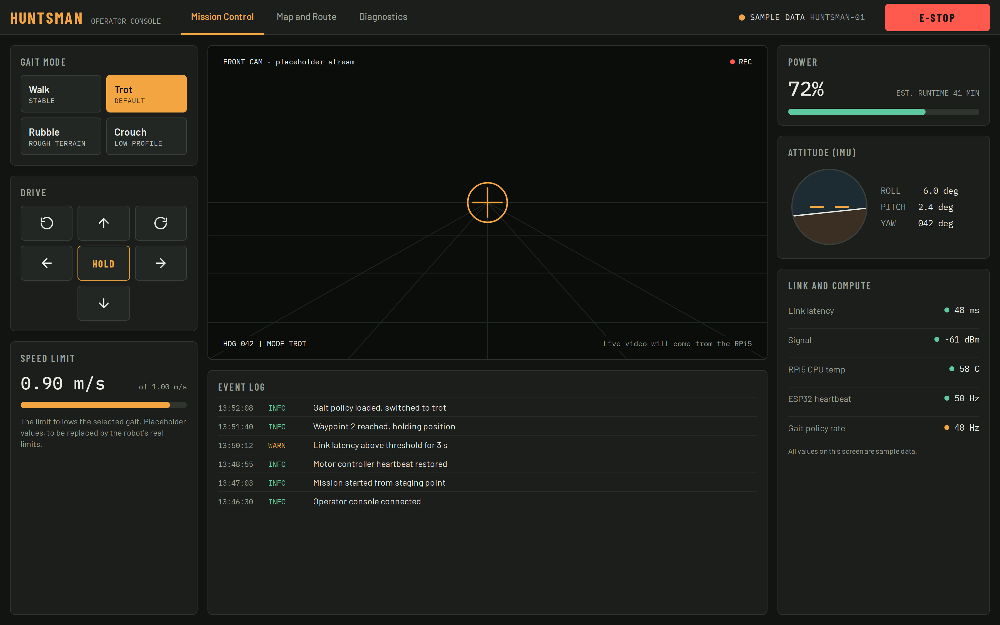 | 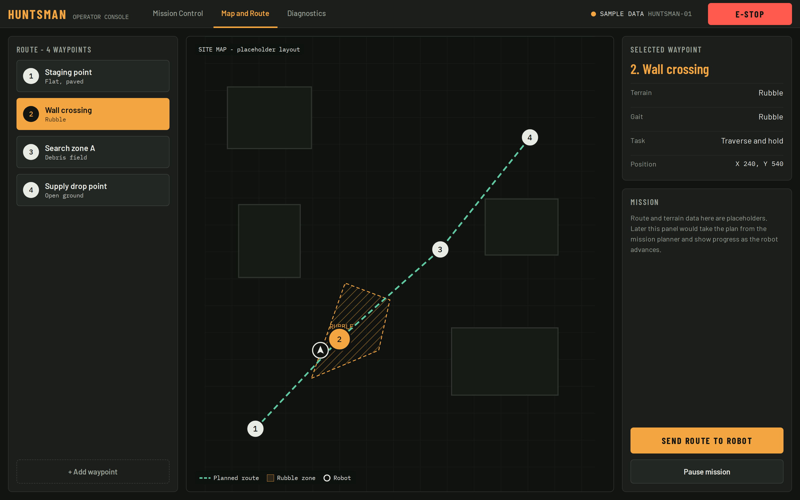 |
| Mission control: gait mode, drive pad, emergency stop, telemetry. | Map and route: waypoints and site map. |
| 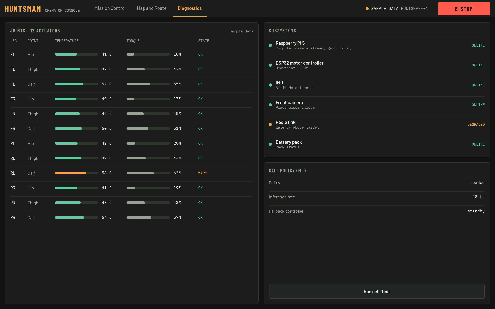 | |
| Diagnostics: joint temperature and torque, subsystem health. | |

All three screens run on sample data in Phase 1; wiring them to the live
drive protocol is the first Phase 2 task.

## Diagrams

| | |
|---|---|
|  | 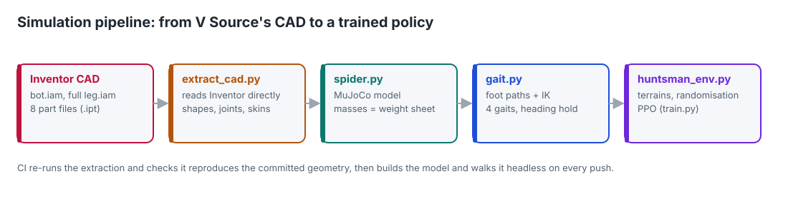 |
| System architecture. | From V Source's CAD to the simulation. |
| 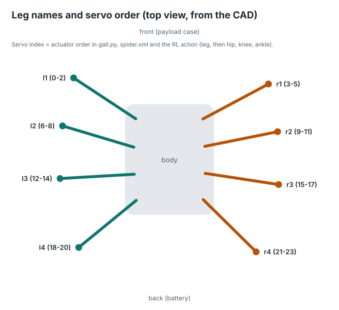 | 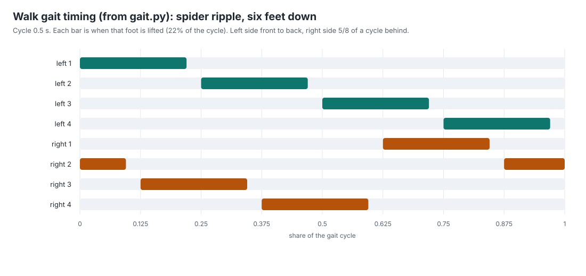 |
| Leg and servo numbering shared by the simulation and the hardware. | Gait timing. |
| 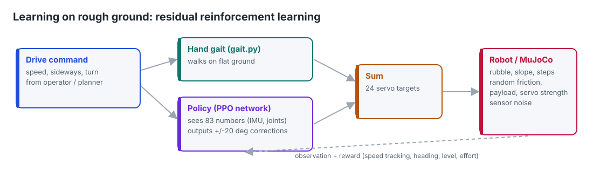 |  |
| Residual reinforcement learning: the learned controller corrects the hand-written gait. | Phase 2 roadmap. |
