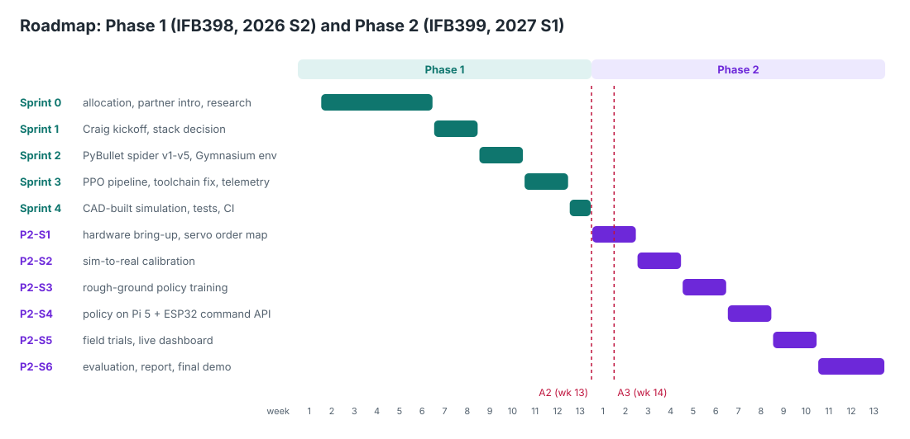

# Phase 1 sprint record (IFB398, 2026 Semester 2)

Sprints are fortnightly and end at a tutor or partner review. Each record
gives the sprint goal, what was done (with evidence in the repository or
the meeting notes), the review outcome, and the retrospective. Story IDs
refer to the [backlog](../agile/backlog.md).

| Sprint | Dates | Goal | Result |
|---|---|---|---|
| 0: Initiation | to 1 Sep | form the team, secure the project, understand the domain | partner confirmed, roles set, research under way |
| 1: Kickoff and stack | 2-8 Sep | understand what V Source needs; choose the stack | stack chosen, repository and board live |
| 2: First walking spider | 9-16 Sep | a spider walking in simulation, wrapped for RL | 24-joint spider walks; environment skeleton; Pi-ESP32 link |
| 3: Learning pipeline | 17 Sep-1 Oct | train a first policy; get every member running | first moving PPO policy; toolchain blocker removed; dashboard prototype |
| 4: The real robot | 2-19 Oct | move from placeholder robot to V Source's real design | CAD-built simulation, gait, terrains, RL environment, tests and CI |

---

## Sprint 0: Initiation (to 1 Sep)

**Goal:** become a team with a confirmed project and a shared
understanding of it.

**Done**

* Team formed after the Week 3 tutorial (7 Aug). First direction and
  research split agreed. Repository created (first commit 8 Aug).
* Allocation concerns raised with the tutor and unit coordinator (Zoom
  with David Lovell, 10 Aug). The team worked through the process to a
  confirmed allocation.
* Partner introduction letter drafted, revised through UC and V Source
  feedback, and approved (16 Aug).
* Full-team meeting (18 Aug) confirmed roles (David PM and comms, Tom
  interface, Kai ML and simulation, Prab hardware), weekly meetings,
  individual work logs and the shared research log.
* Domain research: V Source's work; legged robots in search and rescue;
  RL, PPO, sim-to-real and domain randomisation; Pi 5, ESP32 and PWM;
  SvelteKit.

**Review:** Week 5 tutor meeting (A1.1), 21 Aug.

**Retrospective**

* Keep: written notes for every meeting. They became the source of truth
  when facts were disputed later.
* Change: GitHub invites had expired for some members, so access is now
  checked at every sprint start.

---

## Sprint 1: Kickoff and stack (2-8 Sep)

**Goal:** know exactly what V Source wants and how we will build the
simulation.

**Done**

* Pre-meeting prep (roles, questions, mic checks) and the first meeting
  with Craig (2 Sep, recorded). It corrected our biggest assumption: the
  robot has **eight legs, not four**, with 24 servos. It also confirmed
  the Pi 5 payload and ESP32 chassis architecture, 100% remote work and
  partner compute, and clarified "defence grade" as robustness, not
  weapons. [Minutes](../meetings/2026-09-02_craig_kickoff.md).
* One-hour debrief, then team planning (5 Sep). The Phase 1 sprint plan
  was built and work divided across four tracks.
* Stack decided (8 Sep): PyBullet + Gymnasium + SB3 PPO
  ([ADR 0001](../decisions/0001-simulation-and-rl-stack.md)) and
  WebSockets for telemetry
  ([ADR 0003](../decisions/0003-websocket-telemetry.md)).
* Repository structure (folders, area branches) and Kanban board with
  24 tasks across the simulation, hardware, frontend and PM tracks
  (S5.1). Discord server set up with Craig in it.

**Review:** A1.2 Week 7 summary to the tutor.

**Retrospective**

* Keep: preparing a question list before partner meetings. Every answer
  turned into a task.
* Change: confirm assumptions with the partner before building. The
  four-legs assumption would have cost a sprint.

---

## Sprint 2: First walking spider (9-16 Sep)

**Goal:** a spider walking in simulation, ready to plug into RL.

**Done**

* Kai: spider v1-v5 in PyBullet (S1.1). The walk was straightened in v3,
  and v5 has the full 24 joints after Prab caught that v4 had only 16.
* Prab: Gymnasium environment skeleton with action and observation
  spaces (`spider_env.py`); Pi 5 to ESP32 serial link proof of concept
  (S3.1, `firmware/README.md`).
* Tom: WebSockets chosen over SSE for bidirectional control; data
  formats and update rate set.
* Kai found that PyBullet does not support Python 3.13, and David began
  evaluating alternatives.

**Review:** A1.2 Week 9 summary to the tutor; progress shared with Craig
on Discord.

**Retrospective**

* Keep: cross-checking each other's work. Prab's 16-vs-24 joint catch
  shows why.
* Change: toolchain problems go on the board as blockers the day they
  are found, with an owner.

---

## Sprint 3: Learning pipeline (17 Sep-1 Oct)

**Goal:** train a first policy end to end, and get every member able to
run the simulation.

**Done**

* Kai: `train_ppo` v1-v3 and `watch_trained_policy` (S2.5). 200 k and
  500 k steps were not enough; parallel environments and VecNormalize
  were needed; at 2 M steps the first policy moved (veering left).
* Prab: full PyBullet integration in the environment: joint control,
  action scaling, reward and termination (30 Sep).
* Tom: SvelteKit operator console with mission control, map and
  diagnostics screens on mock data (S4.1, PR #2).
* David: MuJoCo evaluation with a model generator, validator and
  diagnostic harness. It found three geometry faults. He then found
  `pybullet-arm64`, which unblocked the team with no code changes (S1.2,
  [ADR 0002](../decisions/0002-pybullet-arm64.md), PR #3).
* Craig added to GitHub (`@Virologyst`). Compute requirements drafted
  and sent.

**Review:** A1.2 Week 11 summary. Craig had seen the walking simulation
and responded positively. Open question to the tutor: train against
placeholder dimensions, or wait for real ones?

**Retrospective**

* Keep: proving the full pipeline early, even on a placeholder robot.
  Everything learned carried over.
* Change: the robot's real dimensions were now the critical path, so
  chasing the partner for specifications became a named task with an
  owner (Prab).

---

## Sprint 4: The real robot (2-19 Oct)

**Goal:** move from the placeholder robot to V Source's real design, and
leave Phase 1 with a platform ready for Phase 2.

**Done**

* V Source sent videos of the powered robot (3 Oct), the Inventor CAD
  and part-weight sheet (15 Oct), and the battery STEP and plate (18
  Oct). All are in `hardware/` (partner material, not in this public copy).
* Prab: telemetry bridge to the dashboard and the angle-to-PWM mapping
  (S4.2, S3.2).
* Kai: v6 with keyboard driving, turning and seven gears.
* David: the simulation built directly from the CAD (S1.3,
  [ADR 0004](../decisions/0004-cad-calibrated-mujoco.md)):
  * an Inventor reader with no licence needed
  * every part's real shape, joints and mass
  * build checks against the weight sheet
* David: a foot-path gait with four modes, any direction and heading
  hold, and no leg contact (S2.1-S2.4,
  [ADR 0005](../decisions/0005-residual-learning.md)).
* David: live driving from the keyboard, a drive pad and the dashboard
  protocol (S4.3); rough terrains (S1.5); the RL environment with
  residual actions, randomisation and curriculum (S2.7).
* Design findings for V Source (S1.6).
* Team decision (19 Oct): the CAD-calibrated simulation is the platform
  for Phase 2. All branches consolidated into `main` with tests and CI
  (S5.2, [ADR 0006](../decisions/0006-repository-and-quality.md)) and
  documentation (S5.3).

**Measured baseline** (MuJoCo, rubble gait asked for 0.12 m/s, 30 s):

| terrain | slope 15 deg | mixed | steps 50 mm | rubble 80 mm |
|---|---|---|---|---|
| distance | 3.5 m (whole course) | 2.9 m | 0.8 m | 0.6 m |

This is exactly the failure Craig described in his own controller, and
it defines Phase 2's target.

**Review:** A2 presentation (22 Oct); the CAD-built simulation is shared
with Craig through the repository.

**Retrospective**

* Keep: building tooling (readers, checks, tests) instead of hand-copying
  numbers. When the battery files arrived on 18 Oct they were in the
  simulation the same day.
* Change: long-lived area branches drifted apart. Phase 2 uses one
  `main` with short branches and CI.
* Change: work clustered when partner data arrived. Phase 2 plans
  hardware-dependent work behind explicit dependency dates (see the
  [Phase 2 plan](phase2_plan.md)).

---

## Phase 1 deliverables against the brief

| Brief deliverable | Phase 1 status |
|---|---|
| Trained ML gait model(s) for varied terrain | pipeline proven (PyBullet policy moves); CAD-calibrated training environment with terrains ready; terrain policy in Phase 2 |
| Reproducible training and evaluation code | done: `train.py --check`, seeded terrains, headless walk check, CI |
| Firmware and control integration (ESP32 PWM via Pi 5) | serial link proven; servo mapping written; drive protocol defined; hardware bring-up in Phase 2 |
| Prototype on a real platform | Phase 2 (the robot is with V Source; videos received 3 Oct) |
| Technical report and final demo | A3 report (Phase 1); final demo end of Phase 2 |
