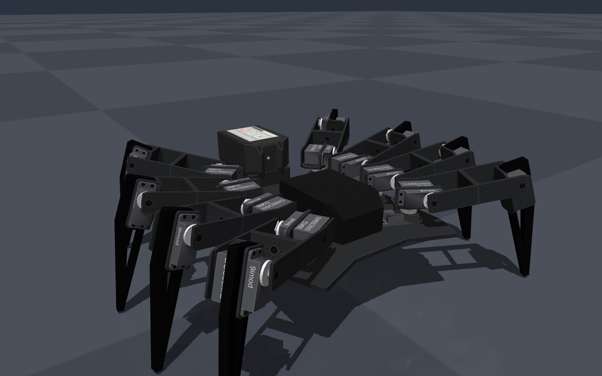

# Huntsman in MuJoCo, built from V Source's CAD

The simulated robot is generated from V Source's own Inventor CAD
(`hardware/cad/inventor`, sent by Ronan Donahoe on 15 Oct 2026), so its shape, joint
positions and masses match the robot they are building. It walks with a
spider ripple gait, and you can drive it from the keyboard, a browser drive
pad, or the team's operator dashboard.




```
pip install mujoco numpy pillow scipy
python spider.py --save        # build spider.xml (+ textures/) and print the checks
python controller.py           # drive it with the arrow keys (plain python, every OS)
mjpython walk.py               # watch it walk straight; add --route for a tour
python walk.py --check         # walk 30 s headless and report
python -m pytest tests         # 54 tests: CAD, gait, protocol, physics, RL env
```

## Driving it

`controller.py` opens the 3D view and serves a drive pad at
**http://localhost:8765**. Drive it like any controller: hold forward (W or up arrow) to walk, add
left or right to curve, hold left or right alone to turn on the spot, let
go to stop; back works the same. Q/E sidestep, Space holds, X is e-stop,
1-4 change gait, and a gamepad plugged into the computer works too. The same server speaks to the team's Svelte dashboard on
`ws://localhost:8765/ws`, using the field names its telemetry store
already has (`rollDeg`, `pitchDeg`, `yawDeg`) on Prab's port.

| send | meaning |
|---|---|
| `{"type":"drive","vx":0.08,"vy":0,"wz":0}` | forward m/s, left m/s, turn deg/s (left +). Repeat every 100-200 ms; 0.5 s of silence = hold |
| `{"type":"hold"}` | stop and stand |
| `{"type":"gait","id":"walk"}` | `walk`, `trot`, `rubble`, `crouch` (the dashboard's four modes) |
| `{"type":"estop","engaged":true}` | freeze every servo where it is / release |

Telemetry comes back 30 times a second: roll, pitch, heading, speed, turn
rate, position, body height, feet down, gait, e-stop and control-loop rate.
A dropped connection stops the robot. No extra packages are needed: the
WebSocket server is Python's standard library.

| gait | what it is | top speed (measured) |
|---|---|---|
| walk | spider ripple, every leg on its own beat, six feet down | 0.20 m/s, 60 deg/s turn |
| trot | alternating tetrapod, four feet down | 0.25 m/s, 60 deg/s turn |
| rubble | ripple with a 50 mm step | 0.12 m/s |
| crouch | ripple with the body 25 mm lower | 0.10 m/s |

In the 3D window: hold the arrow keys (or W A S D) to drive, exactly as
above; Q/E sidestep, Space holds, X is e-stop, 1-4 change gait, R resets,
Esc quits. The window reads each key's real up/down state every frame,
so the robot moves exactly while a key is held.

## How it walks (gait.py)

Feet, not joints. Each foot follows a path in the body's frame and the
three joint angles that put it there are solved by inverse kinematics on
the CAD leg geometry.

* **Planted feet move with the floor.** A planted foot travels backwards at
  exactly the body's speed (and turn), so it does not scrape. The first
  gait swung each leg at the hip, which drags the foot round an arc while
  the body goes straight; that difference was slip.
* **Smooth steps.** A foot leaves the floor moving at its planted speed,
  arcs to its next foothold and lands moving at planted speed again, with
  no vertical speed at lift-off or touch-down.
* **Any direction.** Footholds go half a stride ahead of each leg's home
  in the commanded direction, so forwards, backwards, sideways, turning on
  the spot and curves all come from one rule. The ripple always runs from
  the leading end of each side, so neighbouring legs move the same way and
  never meet.
* **Heading hold.** With no turn commanded, it holds its heading and its
  line (the real robot will do this from its IMU).

Measured in MuJoCo 3.3.7, 30 s at 0.10 m/s, start-up excluded:

| | first gait (hip swing) | this gait |
|---|---|---|
| foot slip while planted | 34 mm/s | 7.6 mm/s |
| body acceleration (rms) | 1.10 m/s² | 0.50 m/s² |
| body jerk (rms) | 102 m/s³ | 42 m/s³ |
| body rocking (rms) | 7.5 deg/s | 3.4 deg/s |
| worst tilt | 1.2 deg | 0.4 deg |
| off its line after 3 m | 11 mm | 1 mm |
| leg-to-leg contact | 0 | 0 |

Backwards, sideways, turning on the spot, curves, stop-start and all four
gaits were each run in the engine with no leg-to-leg contact.

This is the hand-written baseline: the reinforcement-learning policy in
Phase 2 starts from the same model and has to beat these numbers.

## Rough ground and training (Phase 2 set-up)

`terrain.py` puts the same robot on rough ground: `rubble` (rocks up to
80 mm), `slope` (15 deg), `steps` (50 mm) and `mixed`. Drive it there
yourself with `python controller.py --terrain rubble`.

The hand-written gait copes with slopes but not with rubble or steps.
Measured over 30 s (rubble gait, 0.12 m/s asked, 3.5 m possible):

| terrain | distance | what happens |
|---|---|---|
| slope 15 deg | 3.5 m | walks up and down |
| mixed | 2.9 m | veers 24 deg, tilts to 22 deg |
| steps 50 mm | 0.8 m | stalls at the first step |
| rubble 80 mm | 0.6 m | snags on rocks, veers 27 deg |

Recordings of each run: [slope](../../docs/media/video/terrain_slope.mp4),
[mixed](../../docs/media/video/terrain_mixed.mp4),
[steps](../../docs/media/video/terrain_steps.mp4) and
[rubble](../../docs/media/video/terrain_rubble.mp4).

That gap is what the learned controller is for. `huntsman_env.py` is
the training environment (Gymnasium), `train.py` trains it with PPO
(Stable-Baselines3) and `watch_policy.py` shows the result.

* **What it learns:** corrections on top of the hand gait (up to 20 deg
  per servo), not walking from scratch. Starting from a gait that
  already walks makes training far faster and safer.
* **What it sees:** 86 numbers, all measurable on the real robot: joint
  angles and speeds, which way is down, body turn and speed (IMU), the
  drive command, gait phase and its last action.
* **What it is rewarded for:** moving at the commanded speed, holding
  its heading, staying level; small costs for effort and jerky servos; a
  large cost for tipping over.
* **Making it transfer:** every episode draws a new terrain and varies
  friction, payload mass and servo strength, with sensor noise. Terrains
  start gentle and get rougher as it improves (curriculum).

```
pip install -r requirements-train.txt
python train.py --check            # proves the set-up, no training (1 min)
python train.py --steps 200000     # short trial run
python train.py                    # full run, 20 M steps (V Source's cloud)
tensorboard --logdir runs          # watch the reward climb
mjpython watch_policy.py --terrain rubble                       # hand gait
mjpython watch_policy.py runs/<run>/best_model.zip --terrain rubble
```

## How the model is made

```
hardware/cad/inventor  --cad/extract_cad.py-->  cad/huntsman_cad.json  --spider.py-->  spider.xml + textures/
   (Ronan's CAD)                                  (shapes, joints, skins)              (MuJoCo)
```

`cad/inventor.py` reads Inventor 2025+ files directly: each data segment is
Zstandard-compressed, part shapes and every circular edge (holes, horn,
button) come from the ACIS solid inside, and assembly placements are sparse
4x4 matrices. `cad/extract_cad.py` composes `mounted servo` -> `full leg`
-> `bot`, finds the hip, knee and ankle axes from the servo horn frames,
and writes each part twice: a convex shape for collisions, and a "skin"
for looks, the part's real outline extruded through its thickness with
every hole from the part file. `looks.py` paints the skins (the
`9imod / 55KG / DSC55MG` lettering is sized to the raised letters in
`9imod 55kg.ipt`) and `details.py` draws the battery and payload case. When the CAD changes, run:

```
pip install olefile zstandard numpy scipy opencv-python
python cad/extract_cad.py ../../hardware/cad/inventor/
```

## What comes from the CAD and what does not

| From the CAD | Not in the CAD pack (drawn from Ronan's renders) |
|---|---|
| body plate 349 x 230 x 5 mm, outline and every hole | standing pose (Ronan's photos) |
| hip positions, 62 mm apart along each side | servo gains |
| leg fans: 22.7 deg front, 0 middle, 30 deg rear | `case2` payload case, 129 x 93 x 45 mm |
| femur 106 mm, acrylic lower leg 148 mm with its truss window | |
| every part's shape, hole pattern and servo lettering | |
| battery shape, release button and screw heads | |
| masses: Ronan's weight sheet, 4.326 kg | |

**Servo targets are radians.** MuJoCo converts joint ranges to radians
under `angle="degree"` but not actuator control ranges. Earlier versions
sent degrees, which drove every servo into its stop.

## Findings for V Source

* In the CAD the two middle legs on each side have hips 62 mm apart and
  femur brackets 56 mm wide, leaving about 6 mm, so they cannot step
  independently from the CAD pose. The simulation splays them apart
  (`STANCE_YAW` in `spider.py`), as the built robot appears to in the
  photos; worth confirming the real standing angles with Ronan.
* On the right side the third leg's femur meets the rear leg's knee
  bracket if it turns back more than about 22 deg from the CAD position.
* Standing on six feet the knee servo holds about 1.1 N.m, 20% of the
  DSC55MG's 5.4 N.m stall rating; on four feet about 30%.
* We still need the `case2`, `rear rail v2` and `Makitabattery` part files
  to replace the render-sized versions.

## Files

| file | purpose |
|---|---|
| `spider.py` | builds the robot from `cad/huntsman_cad.json`, prints the build report and checks |
| `gait.py` | the walking controller: foot paths, inverse kinematics, four gaits, heading hold |
| `controller.py` | live driving: keyboard, drive pad page and dashboard WebSocket, telemetry out |
| `drive_pad.html` | the drive pad page `controller.py` serves |
| `walk.py` | watch it walk, or `--check` headless |
| `looks.py`, `details.py` | textures and the non-plate details (battery, payload case) |
| `cad/` | Inventor reader (`inventor.py`, `sab.py` for the solid's edges), extractor and the extracted geometry |
| `textures/` | generated by `spider.py`; committed so the viewer works straight away |
| `terrain.py` | rough-ground models: rubble, slope, steps, mixed |
| `huntsman_env.py`, `train.py`, `watch_policy.py` | RL environment, PPO training, viewing a trained policy |
| `diagnostics/` | contact and actuator probes used while tuning |
| `media/` | renders, the walking clip and `progress/`, every version side by side |
| `tests/` | the test suite CI runs on every push ([docs/testing.md](../../docs/testing.md)) |
