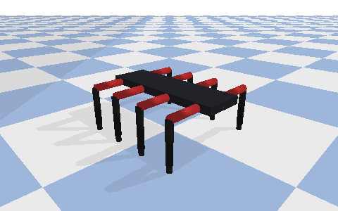
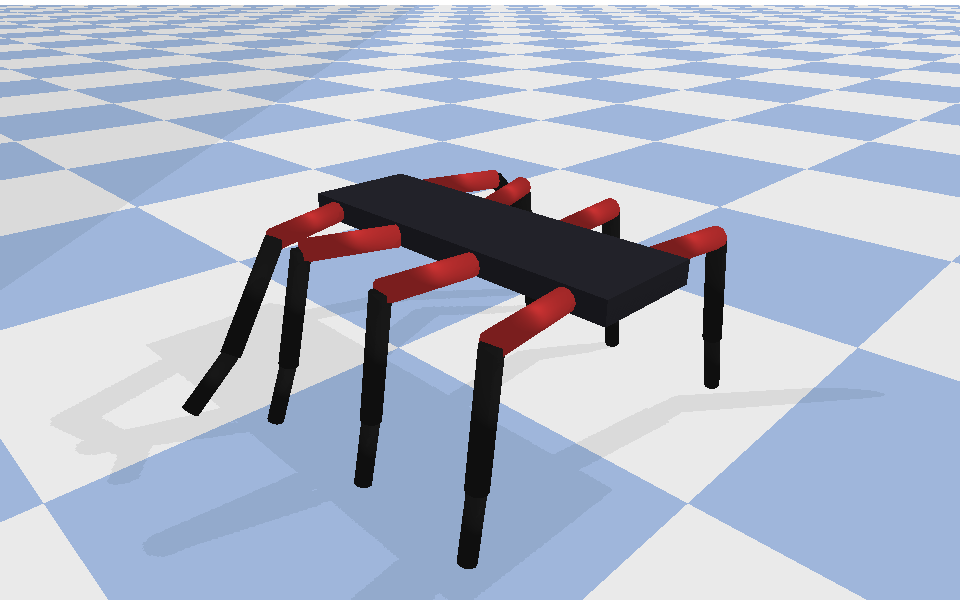

# Huntsman in PyBullet: the Phase 1 prototype (Kai)

This is the team's first walking spider, which Kai built in PyBullet before
V Source's CAD existed. It is drawn from Craig's description of the robot:
a block body, eight legs, three joints per leg and 24 motors. It proved the
whole pipeline: a URDF robot, a hand-written wave gait you can drive from
the keyboard, Prab's Gymnasium environment around it, and PPO training with
Stable-Baselines3.

<p>


</p>

*Recorded headless by `tools/render_pybullet.py`, which runs `spider8_v6.py`
unchanged except for the window and keyboard. The robot is driven forward,
then turned left.*

## Quick start

```bash
cd simulation/pybullet
python3 -m venv .venv && source .venv/bin/activate    # Windows: .venv\Scripts\activate
pip install -r requirements.txt
python spider8_v6.py
```

> **Apple Silicon with Python 3.13:** the upstream `pybullet` wheel will not
> build. Install the maintained fork instead: `pip install pybullet-arm64`.
> It is a drop-in replacement and needs no code changes. Finding this fork
> unblocked the team in Sprint 3 ([ADR 0002](../../docs/decisions/0002-pybullet-arm64.md)).

| Key | Action |
|---|---|
| Up / W, Down / S | walk forward / backward |
| Left / A, Right / D | turn (tank-style: one side takes longer strides) |
| E / Q | gear up / down (7 gears: longer, quicker steps) |
| Space | stop |

## Training a policy (Kai and Prab)

```bash
pip install stable-baselines3
python train_ppo.py              # PPO, 2 M steps, parallel environments (~30 min)
python watch_trained_policy.py   # watch the result in the GUI
```

`spider_env.py` (Prab) is the Gymnasium environment. It has 24 actions,
one per servo, each scaled to that joint's URDF limits, and 31
observations: joint angles, roll, pitch, yaw, body height and velocity.
The reward pays forward speed and costs tilt. Kai's training runs
established what the full pipeline needs:

* 200 k and 500 k steps were not enough: standing still scored almost as
  well as walking, so the policy stood still.
* `SubprocVecEnv` (parallel copies) made training practical on a laptop.
* `VecNormalize` (observation and reward normalisation) was needed before
  PPO learned at all.
* At 2 M steps the first policy produced real movement. It walked fast
  and veered left, which became the next tuning target.

These lessons carried straight into the MuJoCo environment
(`simulation/mujoco/huntsman_env.py`). It uses parallel environments,
VecNormalize, a curriculum, and a residual policy that starts from a gait
that already walks.

## Integration tools (Prab)

| File | Purpose |
|---|---|
| `telemetry_bridge.py` | streams live roll, pitch and yaw from `SpiderEnv` to Tom's dashboard over WebSocket (`ws://localhost:8765`, `rollDeg`/`pitchDeg`/`yawDeg`) |
| `pwm_mapping.py` | converts a policy's joint angle to a servo pulse width (500-2500 us placeholder until the servo datasheet arrives), using each joint's real URDF limits |

The MuJoCo controller kept the same port and field names, so the
dashboard works with either simulation.

## How the prototype evolved (`versions/`)

| Version | What changed | Why |
|---|---|---|
| v1 | static model, no working joints | get a spider-shaped URDF loading |
| v2 | joints and a first walking attempt | walking was not straight or stable |
| v3 | straight walking with 16 joints (hip and knee) | fixed the drift |
| v4 | longer body, refinements | closer to Craig's description |
| v5 | full 24 joints (hip, knee, ankle) | Prab caught that the brief needs 3 joints per leg |
| v6 | keyboard driving, turning, 7 gears | `spider8_v6.py`, the current version |

The training scripts went through the same process: `train_ppo_v1` (200 k
steps), `v2` (500 k, parallel), and `train_ppo.py` (2 M, normalised).

## Tests

```bash
python -m pytest tests -v
```

These check that the URDF has 24 correctly named, mirrored joints with
sane limits and mass on every link. They also check that the Gymnasium
environment resets and steps with the right shapes, that action scaling
reaches the joint limits, and that the PWM mapping is correct. CI runs
them on every push.

## Why the team moved to MuJoCo for Phase 2

PyBullet did its job: it got the team from nothing to a trained,
moving policy in a few weeks. When V Source sent the real CAD on 15 Oct,
the robot it described was different from the prototype:

* 4.33 kg instead of a light block
* 55 kg-cm servos
* legs fanned at different angles
* a battery at one end

The CAD-built MuJoCo model matches that robot part for part, and its
policy is the one that can transfer to the hardware. The decision and
its reasoning are in
[ADR 0004](../../docs/decisions/0004-cad-calibrated-mujoco.md).
